# Signalcraft architecture

Signalcraft is a multi-tenant marketing automation platform. Businesses register, create
organizations, create isolated applications inside them, and run email, SMS and voice
campaigns against per-application audiences.

## 1. System overview

```
Browser (React SPA)
   │  same-origin /api/v1  (Vite proxy in dev, nginx in prod)
   ▼
FastAPI  ──►  service layer  ──►  SQLAlchemy  ──►  MySQL 8 (MariaDB 10.4+ works for local dev)
   │                 │
   │                 └─► Celery tasks (Redis broker) ──► provider adapters (simulation | SES | Brevo | SNS | Twilio | Exotel)
   │                                                        ▲
   └─► /webhooks/{provider} ──► verify signature ──► store raw event ──► async normalise
Celery Beat ──► scheduled campaigns, retries, retention jobs
```

| Layer | Location | Responsibility |
| --- | --- | --- |
| API routers | `backend/app/api/v1` | HTTP only: parse input, resolve tenant context, call a service, commit. |
| Dependencies | `backend/app/api/deps.py` | JWT auth, session check, organization and application context. |
| Tenancy | `backend/app/services/tenancy.py` | Turns a URL id plus the user into a verified `OrgContext` / `AppContext`. |
| Services | `backend/app/services` | All business rules and permission checks. |
| Models | `backend/app/models` | SQLAlchemy 2 declarative models. |
| Providers | `backend/app/providers` | One interface per channel; simulation adapter for each. |
| Tasks | `backend/app/tasks`, `backend/app/workers` | Celery app and background jobs. |
| Frontend API | `frontend/src/api` | Axios client, typed services, TanStack Query hooks. |
| Frontend modules | `frontend/src/modules/*` | Pages per domain. No business rules; the API is authoritative. |

## 2. Tenancy model

```
Platform
 └─ User ──< OrganizationMember >── Organization
                                      ├─ Invitation
                                      └─ Application ──< ApplicationMember >── User
                                           ├─ ApplicationSettings
                                           └─ (Phase 2+) contacts, lists, segments, campaigns, workflows …
```

Rules enforced in `services/tenancy.py`:

1. Every org-scoped route resolves `OrgContext` by joining `organizations` with the caller's
   `organization_members` row. No row means **404**, so other tenants' ids are not confirmed.
2. Every app-scoped route resolves `AppContext` by joining `applications → organizations →
   organization_members`. Owners and admins see every application. Other roles also need an
   `application_members` row.
3. An application role can narrow but never widen the member's organization role.
4. Suspended organizations return `403 ORG_SUSPENDED` for all tenant routes.
5. Every tenant-owned table carries `organization_id` and `application_id`. Repositories and
   services always filter by the ids from the resolved context, never from the request body.
6. Ids supplied inside bodies, such as `application_ids` on an invitation, are validated against
   the caller's organization before use.

## 3. Roles and permissions

Defined in `backend/app/core/permissions.py` and mirrored into `roles`, `permissions` and
`role_permissions` by migration (`core/rbac_sync.py`).

| Role | Scope | Highlights |
| --- | --- | --- |
| Organization Owner | All apps | Everything, including deleting the organization. |
| Organization Admin | All apps | Everything except deleting the organization. |
| Application Manager | Assigned apps | Creates apps, edits settings, manages app access. |
| Campaign Manager | Assigned apps | Audience and campaign write and launch. |
| Analyst | Assigned apps | Read-only plus analytics and billing visibility. |
| Viewer | Assigned apps | Read-only. |

People can only grant roles strictly below their own; owners can grant any role. An
organization always keeps at least one owner.

## 4. Authentication

* Passwords hashed with Argon2id. Login timing is equalised for unknown emails.
* Access token: HS256 JWT, 15 minutes, held in memory by the SPA.
* Refresh token: 48 random bytes in an `httpOnly`, `SameSite=Strict` cookie scoped to
  `/api/v1/auth`. Only its SHA-256 hash is stored in `user_sessions`.
* Refresh rotates the token. Presenting a rotated token revokes the whole session family.
* Every authenticated request checks that the session is still active, so logout, password
  change and password reset take effect immediately.
* Email verification, password reset and invitation tokens are single-use, hashed and expiring.
  Requesting a new one invalidates the old one.
* Forgot-password always answers 202 to avoid account enumeration.
* Auth endpoints are rate limited per IP (Redis, with an in-memory fallback).

## 5. Entity relationship diagram

Phase 1 tables exist now. The rest are the agreed design for later phases.

```mermaid
erDiagram
  users ||--o{ user_sessions : has
  users ||--o{ email_verifications : has
  users ||--o{ password_resets : has
  users ||--o{ organization_members : joins
  organizations ||--o{ organization_members : has
  roles ||--o{ organization_members : grants
  roles ||--o{ role_permissions : has
  permissions ||--o{ role_permissions : in
  organizations ||--o{ invitations : sends
  organizations ||--o{ applications : owns
  applications ||--|| application_settings : configures
  applications ||--o{ application_members : grants
  users ||--o{ application_members : has
  organizations ||--o{ audit_logs : records

  applications ||--o{ contacts : "Phase 2"
  contacts ||--o{ contact_lists : in
  lists ||--o{ contact_lists : contains
  contacts ||--o{ contact_tags : tagged
  tags ||--o{ contact_tags : on
  applications ||--o{ segments : defines
  applications ||--o{ imports : runs
  imports ||--o{ import_rows : has
  contacts ||--o{ consent_records : has
  applications ||--o{ suppression_entries : blocks
  contacts ||--o{ contact_activities : logs

  applications ||--o{ email_campaigns : "Phase 3"
  email_campaigns ||--o{ email_messages : sends
  email_messages ||--o{ email_events : tracks
  applications ||--o{ email_templates : has
  applications ||--o{ email_senders : verifies

  applications ||--o{ sms_campaigns : "Phase 4"
  sms_campaigns ||--o{ sms_messages : sends
  sms_messages ||--o{ sms_events : tracks
  applications ||--o{ sms_templates : has
  applications ||--o{ sms_dlt_configurations : registers

  applications ||--o{ voice_campaigns : "Phase 5"
  voice_campaigns ||--o{ voice_calls : places
  voice_calls ||--o{ voice_events : tracks
  applications ||--o{ voice_audio_assets : stores

  applications ||--o{ workflows : "Phase 6"
  workflows ||--o{ workflow_versions : versions
  workflows ||--o{ workflow_executions : runs
  workflow_executions ||--o{ workflow_execution_steps : has

  organizations ||--|| wallets : "Phase 7"
  wallets ||--o{ wallet_transactions : ledger
  organizations ||--o{ subscriptions : has
  plans ||--o{ subscriptions : priced
  applications ||--o{ usage_records : meters

  users {
    char36 id PK
    varchar email UK
    varchar password_hash
    datetime email_verified_at
    bool is_active
    bool is_platform_admin
  }
  organizations {
    char36 id PK
    varchar slug UK
    varchar status
    datetime deleted_at
  }
  applications {
    char36 id PK
    char36 organization_id FK
    varchar slug "unique per org"
    varchar timezone
    datetime deleted_at
  }
  contacts {
    char36 id PK
    char36 organization_id FK
    char36 application_id FK
    varchar email "nullable, unique per app via email_key"
    varchar phone_e164 "nullable, unique per app via phone_key"
    json attributes
    varchar status
  }
```



Schema conventions:

* UUID primary keys stored as `CHAR(36)`, generated in Python.
* `created_at` and `updated_at` everywhere. `deleted_at` soft deletes on users, organizations,
  applications and, later, contacts and campaigns.
* All timestamps are stored as UTC. MySQL uses `DATETIME(6)`.
* Constraint names follow a fixed naming convention so migrations are deterministic.
* Contacts (Phase 2) will use generated `email_key`/`phone_key` columns that are `NULL` when the
  value is absent. Unique indexes on `(application_id, email_key)` then allow many contacts
  without email while still blocking duplicates. The identity rule per application decides
  which keys are enforced.
* Custom attributes live in a JSON column with per-application attribute definitions. Hot
  attributes get MySQL functional indexes so segment queries stay fast.

## 6. API plan

All routes are under `/api/v1`. Errors use one envelope:
`{"error": {"code", "message", "details", "request_id"}}`. Lists return
`{"items", "total", "page", "page_size"}`. Interactive docs live at `/docs`.

| Area | Endpoints | Status |
| --- | --- | --- |
| Auth | `POST /auth/register, /login, /refresh, /logout, /verify-email, /resend-verification, /forgot-password, /reset-password` | Built |
| Profile | `GET/PATCH /users/me`, `POST /users/me/password`, `PUT /users/me/context`, `GET/DELETE /users/me/sessions` | Built |
| Organizations | `GET/POST /organizations`, `GET/PATCH /organizations/{id}`, `/roles`, `/members`, `/invitations`, `/audit-logs` | Built |
| Invitations | `POST /invitations/preview`, `POST /invitations/accept` | Built |
| Applications | `GET/POST /applications`, `GET/PATCH/DELETE /applications/{id}`, `/settings`, `/members` | Built |
| Dashboard | `GET /apps/{app_id}/dashboard` | Built |
| Regions | `GET /regions`, `GET /applications/{id}/compliance` | Built |
| Contacts | `/apps/{app_id}/contacts` CRUD, `/bulk`, `/export`, `/{id}/consent`, `/{id}/consents`, `/{id}/activity` | Built |
| Imports | `POST /apps/{app_id}/contacts/import`, `/imports/{id}`, `/validate`, `/start`, `/cancel`, `/report` | Built |
| Segments, lists, tags | `/apps/{app_id}/segments`, `/segments/preview`, `/lists`, `/tags`, `/audience/attributes`, `/audience/fields`, `/suppressions`, `/audience/overview` | Built |
| Email | `/apps/{app_id}/email/overview`, `/senders`, `/templates`, `/campaigns` + `/estimate`, `/readiness`, `/preview`, `/test`, `/schedule`, `/unschedule`, `/send`, `/pause`, `/resume`, `/cancel`, `/report`, `/messages` | Built |
| Tracking (public) | `GET /t/o/{token}.gif`, `GET /t/c/{token}/{index}`, `POST /u/{token}`, `/public/unsubscribe`, `/public/email-senders/verify` | Built |
| SMS | `/apps/{app_id}/sms/overview`, `/registration`, `/senders` (+ `/attest`, `/default`), `/templates`, `/campaigns` + `/estimate`, `/readiness`, `/preview`, `/test`, `/schedule`, `/unschedule`, `/send`, `/pause`, `/resume`, `/cancel`, `/report`, `/messages`, `/inbound`, `/simulate-inbound`, `/analyse`, `/pricing` | Built |
| Voice | `/apps/{app_id}/voice/overview`, `/options`, `/callers` (+ `/attest`, `/default`), `/audio` (+ `/upload`, `/tts`), `/campaigns` + `/estimate`, `/readiness`, `/preview`, `/test`, `/schedule`, `/unschedule`, `/send`, `/pause`, `/resume`, `/cancel`, `/report`, `/calls` | Built |
| Voice (public) | `GET /public/voice/audio/{token}`, `GET /public/voice/script/{token}`, `POST /public/voice/keypress/{token}` (signed per recording or call) | Built |
| Automation | `/apps/{app_id}/automation/workflows` CRUD + `/validate`, `/publish`, `/pause`, `/resume`, `/archive`, `/duplicate`, `/stats`, `/runs`, `/runs/{id}`, `/runs/{id}/stop` | Built |
| Analytics | `/apps/{app_id}/analytics?start&end`, `/apps/{app_id}/analytics/export.csv` | Built |
| Billing | `/organizations/{id}/billing`, `/billing/transactions`, `/billing/transactions.csv`, `/billing/test-credit` (simulation only), `/billing/threshold`; `/apps/{app_id}/billing`, `/apps/{app_id}/billing/transactions` | Built |
| Webhooks | `POST /webhooks/email/ses`, `/webhooks/email/brevo?token=`, `/webhooks/email/simulation`; `/webhooks/sms/sns` (SNS signature; SMS receipts come from CloudWatch, not webhooks), `/webhooks/sms/simulation`; `/webhooks/voice/twilio/status` (X-Twilio-Signature), `/webhooks/voice/telnyx/status/{token}/{attempt}` (signed token + Ed25519), `/webhooks/voice/exotel/status?token=`, `/webhooks/voice/simulation` (signed, non-production) | Built |
| Platform admin | `/admin/me`, `/admin/staff` (+ `PATCH`/`DELETE /admin/staff/{id}`), `/admin/support-sessions`, `/admin/organizations/{id}/support-session`, `/admin/support-sessions/{id}/end`, `/admin/overview`, `/admin/settings`, `/admin/organizations` (+ `/suspend`, `/reactivate`, `/wallet`), `/admin/users` (+ `/suspend`, `/reactivate`), `/admin/webhooks` (+ `/retry`) | Built |
| Payments | `/organizations/{id}/billing/payments/options`, `/billing/checkout`, `/billing/payments`, `/billing/payments/{id}`; `/webhooks/payments/stripe`, `/webhooks/payments/razorpay` | Built |
| Monitoring | `/health/live`, `/health`, `/metrics` (bearer token) | Built |

## 7. Background processing

* Celery with Redis. Queues: `default`, `email`, `campaigns`, `imports`, `webhooks`.
* `acks_late` plus `reject_on_worker_lost` so a crashed worker's task is redelivered.
  Every task must therefore be idempotent.
* Transient provider errors retry with exponential backoff and jitter. Permanent failures are
  recorded and never retried.
* Campaign sends create one message row per recipient with a unique
  `(campaign_id, contact_id)` key before dispatch, so a retried batch cannot send twice.
* SMS messages inside quiet hours are marked `deferred` with the time the window ends. Beat's
  `dispatch_due_sms_campaigns` (or the local scheduler thread) wakes campaigns whose messages are due.
* `CELERY_TASK_ALWAYS_EAGER=true` runs tasks in-process for tests and docker-less development.

## 8. Communication safety

* `COMMUNICATION_MODE=simulation` is the default. In simulation, no adapter touches the
  network. Emails land in `backend/var/mailbox` (read at `/dev/mailbox`) and texts in
  `backend/var/sms_outbox` (read at `/dev/sms`) and calls in `backend/var/call_log` (read at `/dev/calls`).
* Live sending needs `COMMUNICATION_MODE=live` plus verified provider credentials, which only
  platform admins can configure. Secrets are encrypted at rest with Fernet (`core/crypto.py`)
  and never returned to organization users.
* Consent, suppression and quiet hours are checked at send time, not only at audience
  selection time.

## 9. Frontend module plan

| Module | Route | Status |
| --- | --- | --- |
| Auth | `/login`, `/register`, `/verify-email`, `/forgot-password`, `/reset-password`, `/invite` | Built |
| Onboarding | `/onboarding/organization`, `/onboarding/application` | Built |
| Shell | Dark sidebar, org and app switchers, Ctrl+K navigation, help and profile menus | Built |
| Dashboard | `/apps/:appId` | Built (Phase 1 data) |
| Application settings | `/apps/:appId/settings` (general, delivery, access, danger zone) | Built |
| Organization | `/orgs/:orgId/applications`, `/team`, `/settings`, `/audit-log` | Built |
| Account | `/account` (profile, password, sessions) | Built |
| Audience | `/apps/:appId/audience` overview, `contacts`, `contacts/:id`, `segments`, `lists`, `tags`, `import`, `fields`, `suppression` | Built |
| Email | `/apps/:appId/email` overview, `campaigns`, `campaigns/:id`, `campaigns/:id/edit`, `templates`, `senders` | Built |
| SMS | `/apps/:appId/sms` overview, `campaigns`, `campaigns/:id`, `campaigns/:id/edit`, `templates`, `senders`, `registration`, `inbox` | Built |
| Voice | `/apps/:appId/voice` overview, `campaigns`, `campaigns/:id`, `campaigns/:id/edit`, `audio`, `callers` | Built |
| Automation | `/apps/:appId/automation`, `/apps/:appId/automation/:workflowId` (React Flow builder and enrollments) | Built |
| Analytics, billing | `/apps/:appId/analytics`, `/apps/:appId/billing`, `/orgs/:orgId/billing` | Built |
| Platform admin | `/admin` (overview, organizations, users, webhooks, settings) | Built |

Unbuilt modules show in the sidebar as non-interactive items marked "Soon". No control is
rendered that does nothing.

## 10. Milestones

1. **Foundation**: auth, organizations, applications, RBAC, invitations, audit log, shell UI. Done.
2. **Audience**: contacts, custom attributes, CSV/XLSX import wizard, lists, tags, segment builder, consent, suppression, India/US regional rules. Done.
3. **Email**: provider adapters, senders, templates and editor, campaign wizard, scheduling, send engine, webhooks, reports. Done.
4. **SMS**: adapters, DLT and 10DLC registration, sender IDs, templates, campaigns, quiet hours, delivery receipts, STOP keywords, cost. Done.
5. **Voice**: adapters, caller IDs, audio library, TTS, campaigns, calling windows, retries, press-9 opt-out, callbacks, cost. Done.
6. **Automation**: React Flow builder, triggers, waits, conditions, splits, contact updates, channel steps through the campaign engines, versioned publishing, run history. Done.
7. **Billing and analytics**: wallet ledger with holds, usage settlement, alerts, cross-channel analytics and export. Done.
8. **Hardening**: platform admin, live payments, monitoring, deployment files and guide. Done (Docker not yet run).

## 11. Regional model (India and United States)

`backend/app/services/regions.py` defines a profile per market: currency, dial code, default
timezone, promotional calling window, whether SMS/voice marketing needs written consent, whether
email needs a postal address, and DLT or 10DLC requirements. Unknown markets get the strictest
profile.

* Phone parsing (`utils/contact_normalize.py`) uses the application's default country, then the
  row's country column, then a full international number, and stores E.164, country, line type
  and timezone. US timezones come from the state when known.
* Consent rules (`services/audience/consent.py`) consult the contact's jurisdiction. The phone
  country decides for SMS and voice, and the address country for email.
* Applications inherit quiet hours from their market when created. The Compliance tab reports
  which requirements are configured.
* Import dates use DD/MM/YYYY for India apps and MM/DD/YYYY for US apps. The UI groups numbers
  in lakh/crore for India.

## 12. Data retention

* Expired or used verification and reset tokens are purged every 6 hours by a beat task.
  Revoked sessions are purged after 30 days.
* Deleted applications are soft deleted immediately (inaccessible, slug freed).
* Deleting a contact is a hard erasure of the contact, consent records and activity. Suppression
  entries keep only a SHA-256 hash and a masked value, so opt-outs stay honoured.
* Raw values of import rows that were not imported are cleared 30 days after the import completes.
* Logs never contain passwords, tokens, secrets or full contact records. A structlog processor
  redacts known sensitive keys.
